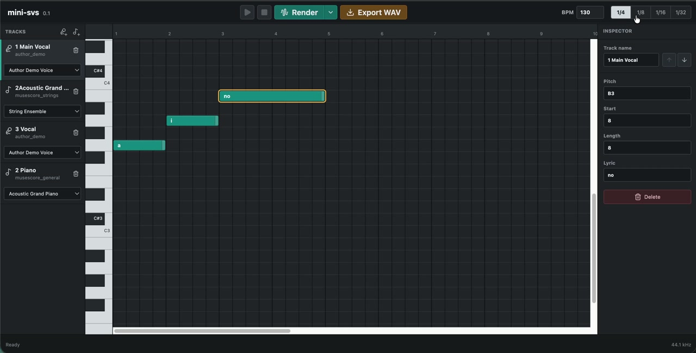

# mini-svs

mini-svs is a small singing voice synthesis app inspired by Vocaloid-style editors. It is a GitHub project and technical demo, not a commercial product operated by the author.

The app is planned around a piano-roll workflow:

- vertical axis: pitch
- horizontal axis: time and note length
- note blocks: lyrics, pitch, start time, and duration

Users will create vocal notes in the editor, choose a voicebank, generate audio, and export or preview the result.

## Demo

[](docs/assets/mini-svs-demo.mp4)

[Watch the 73-second narrated demo](docs/assets/mini-svs-demo.mp4) or try the editor at [mini-svs.com](https://mini-svs.com).

## Project Status

The `0.2.0` specification is active. The first implementation baseline is now in development.

Implemented so far:

- modular FastAPI backend with shared project schemas
- validation for pitches, durations, selected tracks, resource IDs, and output IDs
- local voicebank and instrument catalog boundaries
- React piano-roll editor with vocal and instrument tracks
- note creation, selection, movement, resizing, deletion, and lyric editing
- sample-based vowel synthesis with looping, pitch shifting, and note transitions
- offline vocal and SoundFont instrument WAV rendering, waveform preview, playback, and stop controls
- Cloudflare Worker gateway with a Tunnel to the local Python synthesis service
- backend, frontend, and browser workflow tests

Vocal lyrics accept romaji, hiragana, katakana, and kanji. Japanese text is split into timed mora-sized units before the selected voicebank is queried. A note may contain multiple kana or a multi-mora kanji reading; its duration is shared across the resolved units. Sokuon (`っ`/`ッ`) keeps its timing as a silent consonant closure instead of being pronounced as `tsu`. Every audible phoneme must have a sample in the voicebank. SoundFont instrument tracks render independently through FluidSynth and may be mixed with vocal tracks by the backend.

Adjacent vocal notes use phoneme-aware transitions: vowel onsets receive a longer equal-power crossfade, consonant onsets keep a shorter crossfade for articulation, and pitch changes use Rubber Band's dynamic pitch map instead of mixing two fixed-pitch renders.

The bundled MuseScore General configuration exposes eight selectable presets from the same local SoundFont: acoustic grand piano, nylon guitar, acoustic bass, violin, string ensemble, trumpet, alto saxophone, and flute. Projects can add multiple independent instrument tracks, each with its own notes and General MIDI program, without duplicating the SoundFont file.

Planned first version:

- React/TypeScript piano-roll editor
- Python synthesis backend
- local voicebank loading
- offline `.wav` generation
- audio preview in the frontend

An isolated OpenVPI DiffSinger toolchain and universal 44.1 kHz NSF-HiFiGAN
vocoder can be prepared locally with:

```bash
python3.11 backend/scripts/setup_diffsinger.py
```

This installs the AI framework under `.ai/`; it does not create an author voice
model. Continuous, authorized singing recordings and training are still required
before the AI engine can render the author's voice.

## Voicebanks

mini-svs does not bundle commercial voicebanks, third-party model weights, or third-party singer likenesses by default. Users must download and install any external voicebank according to that voicebank's own license and terms of use.

Candidate resources for local user installation:

| Resource | Notes |
| --- | --- |
| Lingyuosa DiffSinger V1 | DiffSinger voice library; CC BY-NC-SA 4.0; non-commercial use only |
| Tiger DiffSinger | DiffSinger voice library; non-commercial/personal use only; no redistribution or derivatives |
| Canary DiffSinger | DiffSinger voice library; commercial use requires written permission or a commercial license |
| OpenUTAU SVS Index | Useful index for finding DiffSinger/OpenUTAU-compatible voices |

Always verify each voicebank's original license before use. Public download does not mean redistribution, commercial use, or derivative model creation is allowed.

## Author Voice License

Any voice samples, rendered voice demos, or model weights based on the project author's own voice are separate from the source code license.

Unless explicit written permission is granted by the voice owner, the project author's voice may be used only for non-commercial demonstration, testing, and research related to mini-svs. Commercial use, resale, sublicensing, voice cloning outside mini-svs, impersonation, or redistribution as a standalone voicebank/model is not permitted.

The GPL-3.0 license in this repository applies to the source code. It does not grant commercial rights to the project author's voice, likeness, recordings, or voice model weights.

## Instrument Sounds

mini-svs should use existing instrument libraries for accompaniment instead of building instrument sounds from scratch.

Recommended resources:

| Resource | Notes |
| --- | --- |
| MuseScore General SoundFont | General MIDI instruments including piano, saxophone, strings, brass, and drums; MIT license |
| Discord SFZ GM Bank | General MIDI SFZ bank using CC0, CC-BY, or equivalent sources; verify per-instrument attribution |
| Salamander Grand Piano | High-quality piano SFZ; CC BY 3.0 |
| Philharmonia Orchestra Samples | Orchestral and saxophone WAV samples; do not redistribute as a bundled sampler |
| Virtual Playing Orchestra | SFZ/WAV orchestral library; mixed licenses, best installed locally by users |

## Specification

Implementation details are tracked as module-level files in [docs/](docs/).

That folder intentionally contains only numbered module files.

## Development

Backend:

```bash
brew install rubberband # macOS; install rubberband-cli on Linux
brew install fluid-synth # macOS; install fluidsynth on Linux
python3 -m venv .venv
.venv/bin/python -m pip install -e 'backend[dev]'
cd backend
../.venv/bin/uvicorn app.main:app --reload
```

Frontend, in a second terminal:

```bash
cd frontend
npm install
npm run dev
```

Open `http://127.0.0.1:5173`. The Vite development server proxies `/api` requests to the backend at `http://127.0.0.1:8000`.

Select a track and use **Render** to preview that track alone. Open the arrow beside **Render** and choose **Render all tracks** to preview the complete vocal and instrument mix on the shared timeline.

Use **Export WAV** to render every track and download the completed mix. The downloaded file uses the project ID as its filename.

Use the microphone-plus and instrument-plus buttons in the track list to add vocal or instrument tracks. Each track has its own resource menu, notes, and delete button. Rename the active track in the Inspector; switching its voicebank or instrument does not overwrite that name. At least one vocal track is always retained.

Use the up and down arrow buttons beside the track name to reorder the active track.

For batch deletion, hold **Shift**, **Ctrl**, or **Command** while clicking notes, then use the inspector delete button or press **Delete/Backspace**. **Ctrl/Command+A** selects every note in the current track.

## Cloudflare Deployment

The public frontend and `/api` gateway run on the free Cloudflare Workers plan. A named Cloudflare Tunnel forwards API calls to FastAPI on this Mac, where the private voicebank, SoundFont, synthesis tools, and output remain. The site stays visible while the Mac is offline, but rendering then reports that the synthesis backend is offline.

Provision the gateway token without placing it in `.env` or git:

```bash
TOKEN="$(openssl rand -hex 32)"
security add-generic-password -U -a "$USER" -s mini-svs-gateway-token -w "$TOKEN"
cd frontend
printf '%s' "$TOKEN" | npx wrangler secret put BACKEND_GATEWAY_TOKEN
unset TOKEN
```

Create `mini-svs-backend` in Cloudflare Tunnel, publish `backend-origin.mini-svs.com` to `http://127.0.0.1:8000`, then install the login services:

```bash
python3 backend/scripts/install_macos_services.py
cd frontend
npm run deploy
```

The Mac must remain logged in, awake, and online for synthesis. Closing a laptop lid normally suspends the backend. See [docs/09-deployment.md](docs/09-deployment.md) for the complete runtime and security specification.

## License

Source code is licensed under GPL-3.0. See [LICENSE](./LICENSE).
